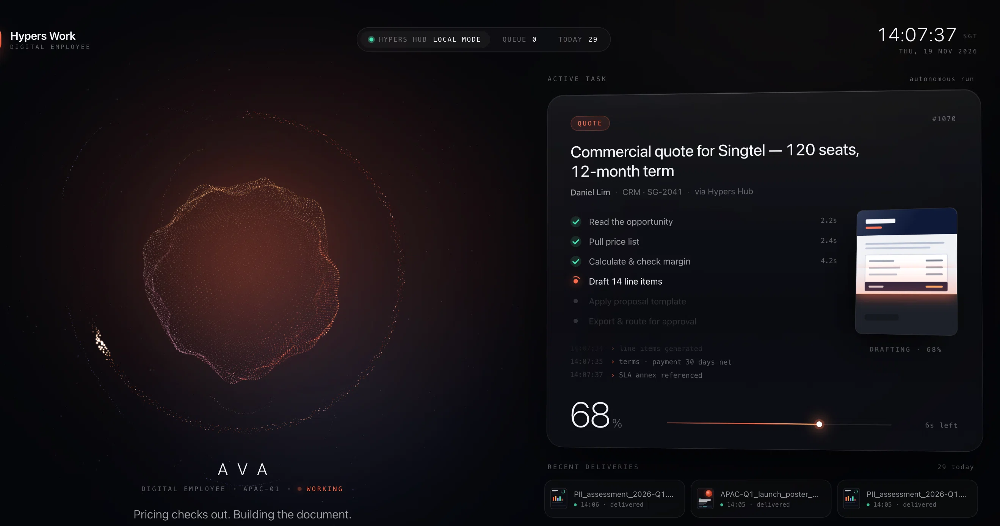

# 全景模式 · Panorama mode

[English](README.md) · [配置说明](docs/configuration.md) · [开发与验证](docs/development.md) · [可信发布](docs/publishing.md) · [更新记录](CHANGELOG.md)

**在 DeepSeek Harness / Hypers Work 中，实时观看 AI 的执行过程。**

全景模式在对话右上角增加一个入口，用粒子光球、执行列表、流式预览和状态反馈，呈现 AI 的思考、工具执行、待办进度与回复。它是独立 Cordis 插件，通过公开扩展点接入，不修改 Agent 执行循环。

## 视觉预览



*此图为用户提供的 HTML 视觉参考截图，不是已安装插件的实机截图。演示中的任务、文件预览、百分比与倒计时仅作示意；插件使用真实对话数据和下文说明的进度规则。当前按钮、品牌与标签可能有所不同。*

## 两种打开方式

点击头部按钮会弹出菜单：

| 菜单项 | 效果 |
| --- | --- |
| **在当前窗口打开** | 全景模式覆盖当前应用视口，保持原有行为，也是默认方式。 |
| **在浏览器中打开** | 打开一个独立的系统浏览器窗口，各自是独立客户端，可多开并分别放到不同显示器。 |

「在浏览器中打开」的做法是：向 Host 索取本次实例的**已认证 GUI 地址**（与产品自身「在浏览器中访问」用的是同一套启动令牌机制），再交给系统浏览器——因为桌面外壳会拒绝应用内弹窗。目标会话无法随地址传递（令牌重定向会丢掉查询参数），所以每个窗口用一个不透明 id 登记会话，并以 `#panorama-window=<id>` 寻址：片段会被重定向继承，既让每个窗口地址各不相同，也让宿主知道该窗口要领哪一条（90 秒过期、消费即删、仅进程内、绝不写日志或落盘），再通过公开的 workspace 服务选中该会话，并**重试到选择真正生效**——新窗口会先恢复共享的持久化选择（`localStorage['dsh.sessions.current']`），而会话列表尚未加载完时第一次调用会被丢弃；不重试的话两个窗口会停在同一个会话。

**浏览器窗口需要先开启浏览器访问。**默认的原生窗口模式下，桌面外壳会对一切普通浏览器请求返回 `forbidden`；产品自身的说明是「浏览器访问仅在兼容模式下可用」。用这个菜单项之前，请到 **设置 → 浏览器与局域网 → 允许在浏览器中打开** 开启（并切换为兼容模式）。打开菜单时会先向宿主查询能力（`GET /api/panoramaMode/state`），因此菜单项本身就带着提示：一个警示点加上需要开启的具体设置名；点选时也只解释这道门（`409 browser-access-disabled`），不会去打开一个打不开的页面。纯 `dsh web` 起的 Host 没有这道门。

使用要点：浏览器窗口带浏览器工具栏，会运行完整客户端（各自占用内存与 GPU），外观设置与主窗口共享，需要系统默认浏览器。兼容模式外壳会直接拒绝弹窗，那里只能用窗口内模式。每个窗口都是独立客户端；依赖「只有一个活跃客户端」的宿主功能在多开时表现可能不同。**插件的权限不足以创建原生第二窗口**：只有 Electron 主进程能建窗口，而渲染进程的桥没有开窗动作。

## 查看输出结果

点击完成卡或“最近结果”，左侧光球区域会切换为平直的玻璃阅读面板，右侧执行信息保留。完整回复支持 Markdown 标题、列表、代码和表格；摘要不再显示原始 Markdown 标记。同一轮只保留最后一条完成回复，Esc 先关闭结果面板。

回复中的网页链接通过用户点击打开新窗口。图片和视频仅点击对应资源卡后加载，视频不自动播放。文档和本地媒体引用使用原生 Chat 收尾区提供的会话文件打开回调；该回调未挂载时显示明确提示，需返回 Chat 打开，不自行拼接文件 URL。结果会合并回复链接与 DSH `deliverables` 的正式 `present` 文件，PPTX、Univer、PNG 等即使未写进回复也会列出，并显示文件名和描述。正式交付文件与普通引用区别标记，不声称已上传或发布。文档内嵌预览仍待扩展。

## 功能

- 实时跟随当前会话的思考与回复文本。
- 工具开始、完成、失败沿用同一个调用 ID，展示参数摘要和耗时，包含嵌套调用。
- 有本轮待办时显示完成比例；没有可靠分母时显示执行活动，不编造百分比。
- 自动主题：冰蓝待命、紫蓝思考、暖橙执行/等待/失败、薄荷绿完成；支持四种固定配色。
- 外圈亮点持续单向循环，与真实任务进度独立。
- 自定义左上角品牌名称、角色代号（默认 AVA）、副标题、单元、动效与粒子密度。
- 最近回复和提供方结算后的 Token 统计。
- 中英文入口，WebGL 不可用时降级为 CSS 光球。

## 安装

仓库已包含构建后的 `client.js`，安装不需要执行构建脚本。

```sh
git clone https://github.com/hypershub/dsh-panorama-mode.git
```

在 Harness 对话中，请 AI 使用 **Plugin Manager 工具**安装本机克隆目录：

```text
请使用 plugin_manager 安装插件：
action: install_bundle
target: /你的绝对路径/dsh-panorama-mode
```

把路径换成自己的克隆目录。`plugin_manager` 是 Harness 工具，不是终端命令。安装影响当前 Profile；不要手工改写 Profile 清单，也不要复制到应用安装目录。

npm 包名为 `@hypershub/dsh-panorama-mode`。当 0.1.0 发布完成后，可以在 Harness 中使用插件管理工具安装：

```text
action: install_bundle
target: @hypershub/dsh-panorama-mode@0.1.0
```

如果注册表尚无该版本，请先使用上面的本地目录安装。npm 发布与市场上架是独立步骤。仓库及本地文件夹名称仍为 `dsh-panorama-mode`。

## 使用

1. 打开一个已有内容的对话，点击右上角 **全景模式**。
2. 点击齿轮或按 **S** 打开设置；修改即时生效，保存到本地。
3. 点击关闭或按 **Esc** 返回对话。设置打开时先关闭设置，输入框获得焦点时先退出编辑。

插件覆盖当前应用视口，但不会进入或退出浏览器/系统原生全屏。如需系统全屏，请使用应用自己的窗口按钮。

本地源码更新后需构建并重载客户端窗口。插件启用成功不等于已经打开的窗口载入了新版 JavaScript。

## 进度如何计算

参考演示页面通过预设步骤和固定耗时推进百分比；真实 AI 无法预先知道后续工具次数和耗时，因此不能直接沿用倒计时。

| 真实情况 | 展示规则 |
| --- | --- |
| 本轮成功调用 `todo_write`，且待办非空 | 已完成项 / 总项数，明确标注“待办完成进度” |
| 本轮没有待办计划 | 工具调用数、不定活动条；不编造百分比或剩余秒数 |
| 待办达到 100%，AI 仍在执行 | 待办已完成，但不会提前宣布本轮结束 |
| `turn/end` 明确记录 `completed` | 本轮完成反馈 |
| 等待审批或用户回答 | 显示等待状态，暂停活跃扫描 |
| 停止、失败或中断 | 显示停止/错误，不冒充成功交付 |

统计覆盖当前已加载的 Chat 窗口，不保证包含全部历史。Token 是提供方结算记录，不是逐字实时估计；最近列表是回复，不代表文件已上传或项目已发布。

## 兼容性与隐私

当前接口检查基于 **DSH core 0.2.2-rc.1**，使用公开 Slot、`useChat`、`useSession`、`useProjection` 和可选会话状态钩子。升级 core 后需重新核对 Chat 与 Slot API，不宣称全版本、全平台兼容。

Host 只提供一个经过鉴权、仅 owner 可访问的 `GET /api/panoramaMode/config` 配置读取端点。插件不注册模型工具、不修改提示词、不写入 Session 事件，也不增加外部遥测或 CDN 资源。外观设置保存在本地；全景模式可能显示任务中的私密文字，屏幕共享时请注意。

## 开发

```sh
npm ci
npm run build
npm test
```

插件开发使用 Node.js 22+；Harness 自身仍需满足其运行时版本要求。React 仅用于开发测试，浏览器运行时使用 Harness 提供的 React。

详情见[开发与验证](docs/development.md)。

## 已知限制

- 空白会话的头部 Utilities 被宿主隐藏，产生内容后才显示入口。
- 画面以 1920×1080 为设计尺寸等比缩放，小屏和移动端尚未专门优化。
- 状态测试与 SSR 无法证明实际 WebGL 画面、浏览器传输和窗口交互正确。
- 当前使用整份 Chat 订阅和已加载窗口折叠，加载超长历史时可能需要后续增量投影优化。
- 部分执行过程标签仍是中文或工具标识，英文界面未完全本地化。
- 外观设置按浏览器/来源保存，不跨账户或云同步；保留旧存储 key 兼容已有配置。

## 许可

插件源码使用 [MIT 许可](LICENSE)。Hypers 标志、参考页面与 shader 来源说明见[第三方声明](THIRD_PARTY_NOTICES.md)。品牌图形的使用不构成商标授权。
